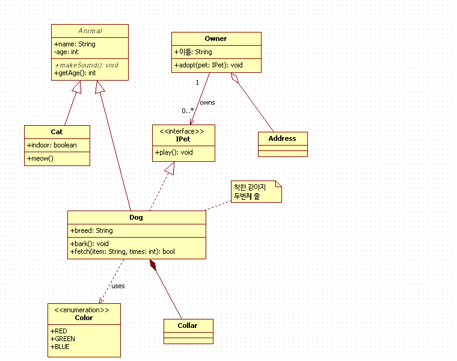
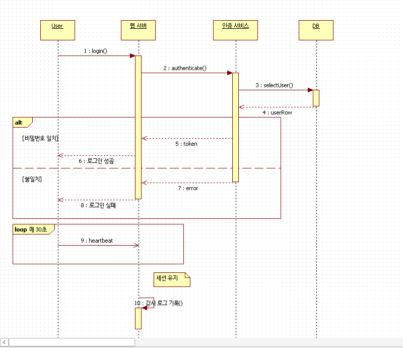
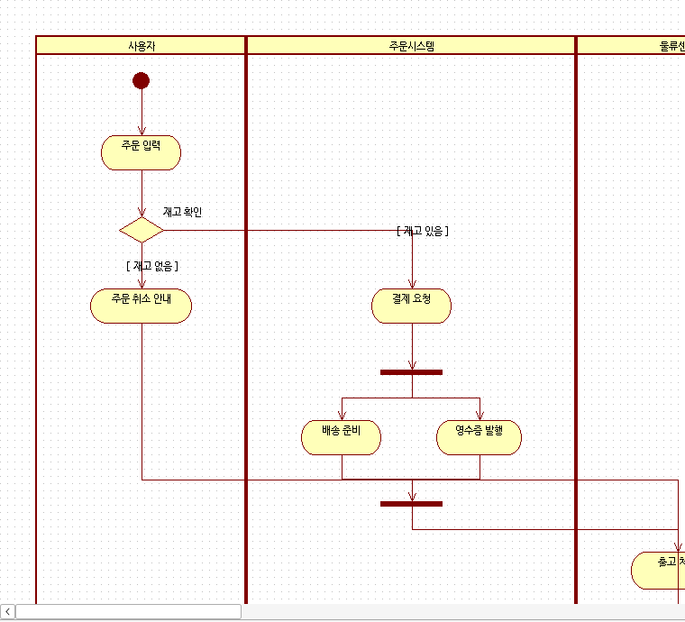
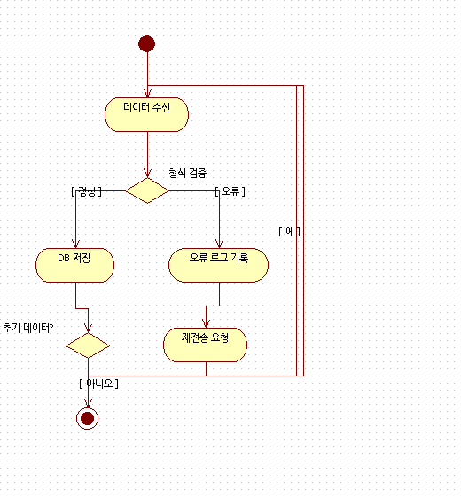

# staruml-50-GPL-sourceforge-plugins

**Mermaid ⇄ StarUML 5.0 (.uml)** 변환기와 StarUML 5.0용 확장 모음입니다.
사람과 AI 에이전트가 함께 쓸 수 있도록 CLI, MCP 서버, StarUML 메뉴 애드인, COM 브리지를 제공합니다.

대상은 SourceForge에 GPL로 공개된 **구버전 StarUML 5.0 (2005, Delphi, `.uml` XML 포맷)**입니다.
`.mdj`를 쓰는 신버전 StarUML(v2 이후)과는 다른 프로그램입니다.

| 클래스 다이어그램 | 시퀀스 다이어그램 |
|---|---|
|  |  |
| **액티비티 다이어그램 (스윔레인)** | **플로우차트** |
|  |  |

위 그림은 모두 `examples/*.mmd`를 변환한 뒤 **실제 StarUML 5.0**(Wine)에서 연 화면입니다.

---

## 무엇을 할 수 있나

| 기능 | 설명 | StarUML 필요 |
|---|---|---|
| `convert` | Mermaid → `.uml` (새 프로젝트로 만들거나 기존 프로젝트에 추가하거나 같은 이름의 다이어그램을 교체) | 아니요 |
| `export` | `.uml`의 다이어그램 → Mermaid (역변환, AI가 기존 다이어그램을 읽고 고칠 때) | 아니요 |
| `fragment` | Mermaid → 모델 프래그먼트 `.mfj` (StarUML *File > Import > Model Fragment*) | 아니요 |
| `list` / `remove` / `validate` | 다이어그램 목록, 삭제, 참조 무결성 검사 | 아니요 |
| `com ...` | 실행 중인 StarUML 제어 (열기, 다시 열기, 자동 레이아웃, 이미지 내보내기, 프래그먼트 가져오기) | 예 |
| `mcp` | AI 에이전트용 MCP 서버 (stdio) | `staruml_com` 도구만 필요 |
| StarUML 애드인 | StarUML의 *Tools > Mermaid* 메뉴에서 가져오기와 내보내기 | 예 |

지원 다이어그램(플러그인)은 다음과 같습니다.

| Mermaid | StarUML 5.0 |
|---|---|
| `classDiagram` | Class Diagram: 클래스, 인터페이스, 열거형, 추상, 스테레오타입, 속성, 오퍼레이션, 일반화, 실현, 연관(다중성, 방향), 집합, 합성, 의존, 노트, namespace→패키지 |
| `sequenceDiagram` | Sequence Diagram: 객체, 호출, 리턴, 비동기, 생성, 파괴 메시지, 자기호출, 활성화 박스, Combined Fragment (`alt/else`, `opt`, `loop`, `par/and`, `critical`, `break` ...), 노트 |
| `flowchart` / `graph` | Activity Diagram: 액션, 판단(질문 텍스트 포함), 병합, fork/join, 서브액티비티, 시작, 종료, `subgraph`→스윔레인, 가드 조건 |

> StarUML 5.0에는 플로우차트 전용 다이어그램이 없어서, 플로우차트는 UML 액티비티 다이어그램으로 그립니다.

---

## 빠른 시작 (Windows)

준비물은 StarUML 5.0 ([SourceForge 공식 배포](https://sourceforge.net/projects/staruml/files/staruml/5.0/))과 Python 3.8 이상입니다. 외부 패키지는 필요 없고 표준 라이브러리만 씁니다.

```bat
git clone <this repo> staruml5-plugins
cd staruml5-plugins

:: 새 프로젝트 만들기
python -m staruml5 convert examples\sequence_basic.mmd -o out.uml

:: 기존 프로젝트에 추가 (같은 이름의 다이어그램이 있으면 교체, out.uml.bak 백업 생성)
python -m staruml5 convert my_seq.mmd --into MyProject.uml --package "Design Model::Orders" --name "로그인 시퀀스"

:: 여러 개를 한 번에
python -m staruml5 convert a.mmd b.mmd c.mmd -o all.uml

:: 기존 다이어그램 -> Mermaid
python -m staruml5 list MyProject.uml
python -m staruml5 export MyProject.uml "로그인 시퀀스" -o login.mmd
```

다이어그램 이름은 `--name`, Mermaid front-matter의 `title:`, 파일 이름 순으로 정합니다.
색은 `--style default` (StarUML 기본: 갈색 선과 연노랑 채우기), `mono` (흑백), `none` (StarUML 옵션을 따름) 중에서 고릅니다.

### StarUML 메뉴 애드인 설치

관리자 권한 명령 프롬프트에서 다음을 실행합니다.

```bat
staruml-addin\install.bat            :: 또는 install.bat "D:\Apps\StarUML"
```

StarUML을 다시 시작하면 **Tools > Mermaid** 메뉴가 생깁니다.

- **Import Mermaid file...**: Model Explorer에서 선택한 패키지(없으면 Design Model) 아래에, 다이어그램 이름의 패키지로 가져온 뒤 바로 엽니다.
- **Export selected diagram to Mermaid...**: 선택한 다이어그램을 Mermaid로 변환해서 메모장으로 엽니다.

애드인은 `%APPDATA%\staruml5-mermaid\config.ini`(`python=`, `repo=`)를 보고 이 레포의 Python 코드를 호출합니다.

### 실행 중인 StarUML 제어 (COM 브리지)

```bat
python -m staruml5 com status
python -m staruml5 com open out.uml            :: 저장하지 않은 변경이 있으면 거부 (--force로 무시)
python -m staruml5 com reload                  :: 파일을 다시 쓴 뒤 화면 갱신
python -m staruml5 com layout "로그인 시퀀스"   :: StarUML 내장 자동 레이아웃 실행 후 저장
python -m staruml5 com export "로그인 시퀀스" C:\tmp\login.jpg    :: jpg | bmp | emf
python -m staruml5 com import-fragment x.mfj "Design Model"
```

pywin32 없이 Windows에 기본으로 들어 있는 `cscript`(JScript)로 StarUML의 COM 서버(`StarUML.StarUMLApplication`)를 호출합니다.

---

## AI 에이전트 연동 (MCP)

```bash
# Claude Code
claude mcp add staruml5 -- python -m staruml5 mcp
```

Claude Desktop이나 기타 MCP 클라이언트(`claude_desktop_config.json` 등)에는 다음처럼 등록합니다.

```json
{
  "mcpServers": {
    "staruml5": {
      "command": "python",
      "args": ["-m", "staruml5", "mcp"],
      "env": { "PYTHONPATH": "C:\\path\\to\\staruml5-plugins" }
    }
  }
}
```

| 도구 | 용도 |
|---|---|
| `mermaid_syntax_help` | 다이어그램별로 지원하는 Mermaid 문법 (에이전트가 먼저 읽기) |
| `mermaid_to_staruml` | Mermaid를 `.uml`로 저장 (새 파일 또는 `into_path`에 추가하거나 교체) |
| `staruml_list_diagrams` | 다이어그램 목록 |
| `staruml_to_mermaid` | 기존 다이어그램을 Mermaid로 읽기 |
| `staruml_remove_diagram` / `staruml_validate` | 삭제, 검증 |
| `staruml_com` | 실행 중인 StarUML 제어 (`open`, `reload`, `layout`, `export`, `import-fragment` ...) |

권장 흐름은 다음과 같습니다. 자세한 내용은 [docs/AGENT.md](docs/AGENT.md)에 있습니다.

1. `staruml_to_mermaid`로 기존 다이어그램을 읽습니다.
2. Mermaid를 수정합니다.
3. `mermaid_to_staruml`의 `into_path`에 같은 이름으로 넣어 교체합니다.
4. `staruml_com reload`로 StarUML 화면을 갱신합니다.

---

## Linux / macOS에서 Wine으로 실행

이 레포는 **Linux(Ubuntu 24.04, wine 9.0)에서 실제로 검증**했습니다. 설치, 실행, 한글 표시, COM 브리지(open/list/show/import-fragment), 애드인 메뉴 등록까지 확인했습니다.
macOS는 같은 스크립트로 시도할 수 있게 해 두었지만 **아직 검증하지 않았습니다**. 자세한 내용은 [wine/README.md](wine/README.md)에 있습니다.

```bash
# Ubuntu / Debian
sudo dpkg --add-architecture i386 && sudo apt update
sudo apt install wine wine32 wine64 innoextract fonts-nanum
wine/install.sh --download --addin        # SourceForge 공식 설치파일을 받아 ~/.wine-staruml5 에 설치
wine/run-staruml.sh                        # 실행 (LANG=ko_KR.UTF-8 로 한글 CP949 처리)

# 호스트의 Python에서 그대로 제어
WINEPREFIX=~/.wine-staruml5 LANG=ko_KR.UTF-8 python3 -m staruml5 com status
```

| 환경 | 상태 |
|---|---|
| Linux x86_64 | 검증 완료 (Ubuntu 24.04, wine 9.0, 32비트 프리픽스) |
| macOS Intel | 실험적: `brew install --cask --no-quarantine wine-stable` + `brew install innoextract` 후 `wine/install.sh` |
| macOS Apple Silicon | 실험적: Rosetta 2 + 위와 같은 Wine (32비트 앱은 wow64로 실행) |

Wine에서 알려진 제약은 다음과 같습니다.
- `com export`(이미지 내보내기)가 Wine에서 `E_NOTIMPL`로 실패합니다. Windows에서는 문제없을 것으로 예상합니다. [TODO.md](TODO.md)에서 추적합니다.
- 메뉴 애드인은 프리픽스 안에 Windows용 Python이 있어야 동작합니다. 호스트에서는 CLI와 COM 브리지를 쓰면 됩니다.

---

## 레포 구조

```
staruml5/
  core/                    포맷 계층 (다이어그램 무관)
    xpd.py                 .uml/.mfj(XPD XML) 객체 모델, 무손실 읽기/쓰기, 삭제, 검증
    views.py               StarUML 뷰 구조 생성기 (라벨, 컴파트먼트, 양방향 참조)
    layout.py              계층형(Sugiyama) 자동 배치, 스윔레인 지원
    ir.py                  다이어그램 중간표현 (Mermaid <-> StarUML 공통)
  plugins/                 다이어그램별 플러그인 (parser + builder + exporter)
    class_diagram/
    sequence_diagram/
    activity_diagram/      (flowchart 포함)
  bridge/                  COM 브리지 (staruml_bridge.js + Python 래퍼)
  api.py  cli.py  mcp_server.py
staruml-addin/             StarUML 5 메뉴 애드인 (Tools > Mermaid) + install.bat
wine/                      Linux/macOS 설치·실행 스크립트와 가이드
examples/                  예제 Mermaid
docs/                      포맷 분석(FORMAT.md), COM API 덤프(com-api.txt), 에이전트 가이드
tools/tlbdump.py           StarUML.exe 타입 라이브러리 덤프 도구
tests/                     python -m unittest discover -s tests
```

새 다이어그램 종류를 추가하려면 `staruml5/plugins/<name>/`에 `parser.py`, `builder.py`, `exporter.py`, `__init__.py`(`PLUGIN = DiagramPlugin(...)`)를 만들고 `plugins/__init__.py`의 `_PLUGIN_MODULES`에 등록하면 됩니다. 각 플러그인 폴더의 README에 매핑 표가 있습니다.

## 어떻게 만들었나

- StarUML 5.0 설치파일(Inno Setup)을 `innoextract`로 풀어서 내장 COM 타입 라이브러리를 덤프했습니다([docs/com-api.txt](docs/com-api.txt), `IUMLFactory` 등 287개 타입).
- 실제 StarUML을 COM으로 조작해 클래스, 시퀀스, 액티비티 다이어그램 정답 파일을 만들고, 생성기가 StarUML과 같은 객체 구조를 쓰도록 맞췄습니다([docs/FORMAT.md](docs/FORMAT.md)).
- 생성된 파일은 모두 StarUML 5.0에서 직접 열어 확인했습니다. 읽기/쓰기는 StarUML이 저장한 파일과 바이트 단위로 같게 왕복합니다(테스트 포함).
- StarUML 바이너리는 수정하지도 재배포하지도 않습니다. 파일 포맷과 StarUML이 공개한 COM 자동화 및 애드인 인터페이스만 사용합니다.

## 라이선스

GPL-2.0-or-later ([LICENSE](LICENSE)). StarUML 5.0과 같은 라이선스입니다.
이 도구로 생성한 `.uml`, `.mfj`, `.mmd` 파일(출력물)은 사용자의 것이며 이 라이선스의 적용을 받지 않습니다.

StarUML™은 해당 권리자의 상표입니다. 이 프로젝트는 StarUML 또는 MKLab/Plastic Software와 관련이 없는 비공식 확장입니다.
